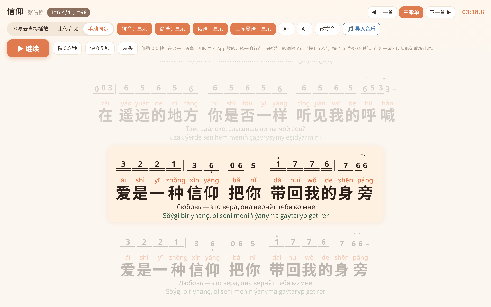
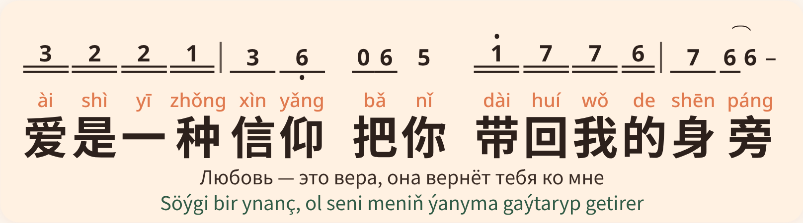
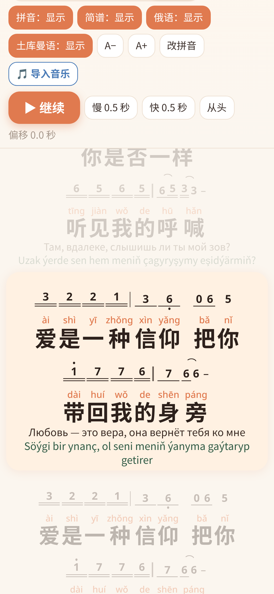
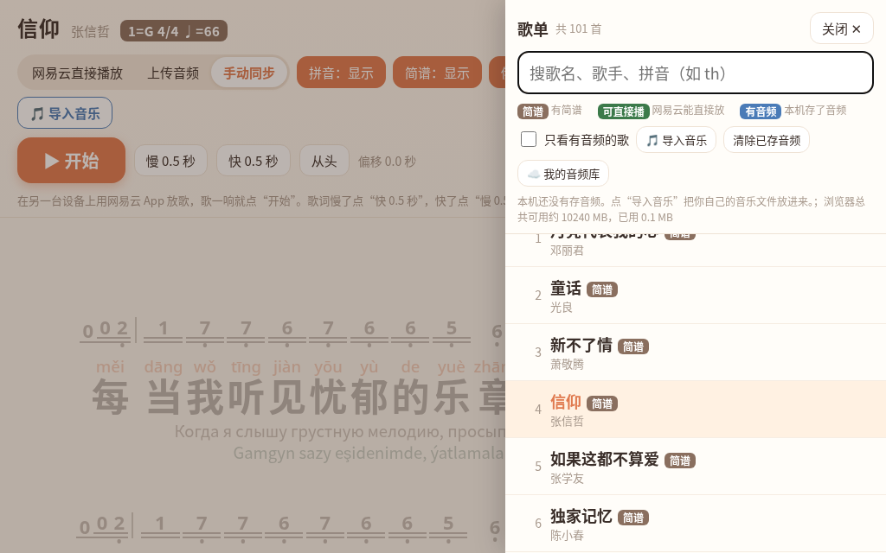

# 拼音歌词 101 首

“拼音歌词101首”是王老师为汉语课堂开发的网页小工具，收录 101 首经典华语流行歌曲。歌词随音乐逐句滚动，每个汉字上方标注拼音，并配有简谱和俄语、土库曼语对照翻译，方便留学生边听边唱，在歌曲中练习发音、声调和词汇。手机或电脑的浏览器都能直接打开，不用安装。

**在线打开：<https://wangshiyun404.github.io/pinyin-geci/>**

| 单句细节 | 手机版 |
| --- | --- |
|  |  |

## 使用说明

### 1. 选歌
点右上角「☰ 歌单」，可以按歌名、歌手或拼音首字母（如 `th`）搜索。点「◀ 上一首 / 下一首 ▶」换歌。

### 2. 让歌词跟着歌走（三选一）
- **网易云直接播放**：歌单里标有「可直接播」的歌，选这一项就能直接播放。
- **用自己的音乐**：点「🎵 导入音乐」，选手机或电脑里的歌曲文件，文件名里有歌名就能自动配对；也可以点「上传音频」给当前这首选一个文件。音频只存在自己的设备上，不会上传。
- **手动同步**：在另一台设备上用网易云音乐 App 播放，歌一响就点「▶ 开始」。歌词慢了点「快 0.5 秒」，快了点「慢 0.5 秒」；点某一句可以从那句重新计时。

### 3. 调整显示
「拼音 / 简谱 / 俄语 / 土库曼语」四个按钮可分别显示或隐藏；「A− / A+」调整字号；「改拼音」可修改个别字的读音。

### 4. 我的音频库（需访问码）
点「☰ 歌单」→「☁️ 我的音频库」，在「访问码」一栏粘贴访问码，点「保存并测试」。成功后可直接播放原有 100 首的音频（新增的《美丽的神话》音频库里暂时没有，可用「导入音乐」自己添加）；点「⬇️ 全部预先缓存」可把音频存到本机，之后没网也能用。

**访问码请向王老师索取，仅限本人使用，请勿转发或公开。** 访问码只保存在你自己浏览器的本地存储里，不会写进本仓库或网页。

### 5. 打不开怎么办
GitHub Pages 在国内大部分网络可以访问，个别网络可能打不开。可以换一个网络试试，或在手机的「私人 DNS」里填 `dns.alidns.com` 后再打开。

## 内容说明
- **简谱**：依据已出版的曲谱整理，个别歌曲简谱暂缺或不完整。标有「单谱」的句子只找到一份曲谱，未交叉核对。
- **翻译**：俄语、土库曼语翻译为 AI 生成的初稿，尚未经母语者审校，仅供参考。
- **歌词与时间轴**：来自网易云音乐的公开歌词。
- **音频**：本仓库不包含任何歌曲音频（版权原因）。

开发过程中借助 AI 完成编程和翻译初稿。歌词、曲谱和歌曲的版权归原作者所有，本工具仅用于课堂教学。

## 文件结构
- `index.html`：整个工具就是这一个网页文件，可以直接下载后用浏览器离线打开。
- `docs/`：说明用的截图。
